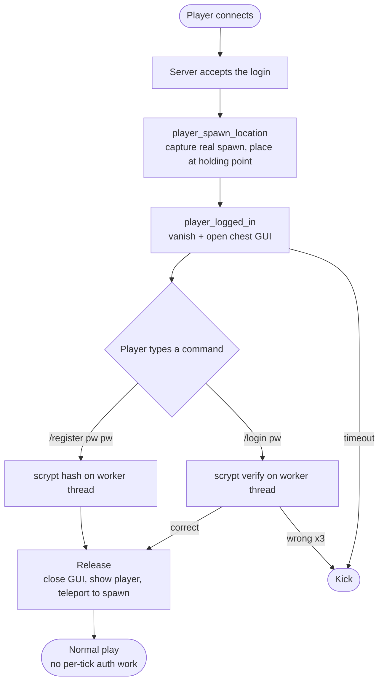

<div align="center">

# Horizon GUI Auth

**A native Rust login gate for Horizon servers.**  
Chest-menu interface · mandatory register/login · scrypt-hashed SQLite accounts · no Java proxy, no plugin, no limbo server.


[Report](REPORT.md) · [The mod](horizon-auth/) · [Config](#configuration) · [Deploy](#deploy)

</div>

---

## What it does

Horizon GUI Auth puts every joining player into a **holding state before the real
world is sent to them**:



While unauthenticated, the player:

- is frozen in place,
- cannot chat,
- cannot run any command except the auth commands,
- cannot use, break, place, attack, drop, pick up, or move items,
- sees a vanilla **3-row chest menu** with Register / Login / Change password,
- is hidden from ordinary players and the Tab list.

On success the GUI closes, the player is shown again, and they are teleported to
the configured spawn (or their original saved position).

> **F3 caveat:** a server cannot hide F3 coordinates. The protection is that the
> real spawn/base region is **never sent** before authentication. The holding
> point is 100,000 blocks away by default and configurable.

---

## Pick your path

<details>
<summary><b>🧱 I want to deploy this on my Horizon server</b></summary>

### 1. Build the engine on your PC — not on the server VM

The mod is compiled **into** the engine. Build on Ubuntu 24.04 x86_64 (or WSL2
Ubuntu), then copy only the finished export to the server.

```sh
horizon-launcher native-build "/path/to/horizon-auth" \
  --server-output "$HOME/horizon-engine" \
  --version nightly-2026-11-08 \
  --trust-native-code
```

> Horizon does not cross-compile. A Windows `.exe` will not run on Ubuntu.
> Do not build this on the 952 MB target VM.

### 2. Point the server at the export

```sh
sudo rsync -a "$HOME/horizon-engine/" /opt/horizon-engine/

horizon-server --dir /srv/horizon init
horizon-server --dir /srv/horizon config set engine.path=/opt/horizon-engine/horizon-engine
horizon-server --dir /srv/horizon restart
```

### 3. Join and test

- New player → `/register <password> <password>`
- Returning player → `/login <password>`
- Wrong password ×3 → kicked
- Wait 5 minutes → timeout
- Reconnect → account still there

Full systemd unit and RAM notes: **[REPORT.md](REPORT.md#8-build-and-deploy-on-ubuntu-2404-x86_64)**.

</details>

<details>
<summary><b>🛠️ I want to read or modify the Rust code</b></summary>

| File | What it does |
|---|---|
| [`api/src/auth.rs`](horizon-auth/api/src/auth.rs) | The gate: hooks, commands, holding state, release |
| [`api/src/menu.rs`](horizon-auth/api/src/menu.rs) | Chest-menu layout and buttons |
| [`api/src/password.rs`](horizon-auth/api/src/password.rs) | scrypt hashing and constant-time verify |
| [`api/src/store.rs`](horizon-auth/api/src/store.rs) | SQLite accounts, audit log, lockout |
| [`api/src/offline.rs`](horizon-auth/api/src/offline.rs) | Java offline UUID (`OfflinePlayer:<name>`) |
| [`api/src/config.rs`](horizon-auth/api/src/config.rs) | JSON config and limits |
| [`horizon-mixin.toml`](horizon-auth/horizon-mixin.toml) | Native bundle manifest / Horizon pin |

Local type-check against a Horizon checkout:

```powershell
# See REPORT.md §7 for the exact .cargo/config.toml patch.
cd horizon-auth/api
cargo check
```

The final `Cargo.toml` depends on:

```toml
horizon-client = { git = "https://github.com/horizon-rust/horizon", rev = "084b20d5..." }
```

</details>

<details>
<summary><b>🔐 I only care about the security model</b></summary>

- Passwords are **never** stored in plaintext.
- Hash: `scrypt$<log_n>$<r>$<p>$<salt_b64>$<hash_b64>`
- 16-byte random salt per password, 32-byte output.
- Comparison is constant-time (`subtle::ConstantTimeEq`).
- Hashing runs on Horizon’s **worker pool**, not the server tick thread.
- Default scrypt cost: `log_n = 15` → 32 MiB and ~50–100 ms per hash.
- Account lockout: 5 failures across sessions → 5-minute lock.
- Session limit: 3 wrong passwords → kick.
- Per-IP limits: 3 pending players, 10 connections/minute, 10 failures/10 min.
- SQLite runs in WAL mode with a 5-second busy timeout.
- Audit table records register/login/password events; **never the password**.
- The mod does **not** add transport encryption. Do not reuse important passwords
  on an offline-mode server.

The brief suggested argon2 or bcrypt. A native Horizon mod may only use crates in
Horizon’s `Cargo.lock`; the lock contains **scrypt 0.11**, not argon2/bcrypt, so
scrypt is used deliberately.

</details>

<details>
<summary><b>❓ FAQ</b></summary>

**Does it work with cracked clients?**  
Yes. It is designed for `online-mode=false`; accounts are keyed by name, and the
offline UUID is stored for audit.

**Do players need a client mod?**  
No. The GUI is a vanilla chest menu (`generic_9x3`), so a stock 26.3 client shows it.

**Can this replace Velocity/LimboAuth/AuthMe?**  
For the “log in before entering the world” job, yes. It is not a proxy and does
not do Mojang session auth, UUID forwarding, or cross-server sync.

**Can players see the holding coordinates?**  
Yes, with F3. That is a client feature and cannot be hidden server-side. The real
world is not sent until login, which is the actual protection.

**What happens if the server restarts while someone is waiting?**  
They are disconnected. Accounts are already saved in SQLite by then if
registration finished.

**Why is my player still frozen after login?**  
Check the server log for `horizon-auth` errors and confirm the teleport target is
inside the world border. The mod falls back to `/execute in ... run tp` if the
direct teleport is refused.

</details>

---

## Player commands

| Command | Who | What |
|---|---|---|
| `/register <password> <password>` | unauthenticated | Create an account and log in |
| `/login <password>` | unauthenticated | Log in |
| `/changepassword <old> <new>` | authenticated | Change password |
| `/changepassword <new> <new>` | authenticated | Change password without repeating the old one |
| `/auth` | anyone | Show help |
| `/authreload` | operator level 4 | Reload `config.json` |

Aliases: `reg`, `l`, `changepw`, `cp`.

Passwords: 6–64 characters, no spaces or control characters, not your name, not
one repeated character.

---

## Configuration

On first run the mod creates:

```text
<engine config folder>/horizon-auth/config.json
<engine config folder>/horizon-auth/accounts.db
```

Default config:

```json
{
  "enabled": true,
  "holding": {
    "dimension": "minecraft:overworld",
    "x": 100000.5,
    "y": 300.0,
    "z": 100000.5,
    "yaw": 0.0,
    "pitch": 0.0
  },
  "timeout_seconds": 300,
  "max_attempts": 3,
  "min_password_length": 6,
  "max_password_length": 64,
  "max_pending_per_ip": 3,
  "max_connects_per_ip_per_minute": 10,
  "max_login_failures_per_ip": 10,
  "login_failure_window_seconds": 600,
  "account_lock_after": 5,
  "account_lock_seconds": 300,
  "allow_ops": false,
  "ops_level": 4,
  "release_mode": "spawn",
  "spawn": null,
  "spawn_dimension": null,
  "spawn_yaw": 0.0,
  "spawn_pitch": 0.0,
  "scrypt_log_n": 15,
  "database": "accounts.db",
  "hide_pending_players": true
}
```

<details>
<summary><b>What the important keys mean</b></summary>

| Key | Meaning |
|---|---|
| `holding` | Where unauthenticated players wait. Must be inside the world border and away from anything private. |
| `timeout_seconds` | Time allowed to log in. `0` disables the timeout. |
| `max_attempts` | Wrong passwords before a kick. |
| `account_lock_after` | Wrong passwords across sessions before a temporary lock. |
| `release_mode` | `spawn` = world spawn / configured spawn; `saved` = the position Horizon chose before the holding override. |
| `spawn` | Optional explicit `[x, y, z]` release point. Overrides the captured world spawn. |
| `scrypt_log_n` | Memory cost: 12 = 4 MiB, 15 = 32 MiB, 17 = 128 MiB. |
| `allow_ops` | If true, operators at `ops_level` skip the gate. Off by default. |
| `hide_pending_players` | Vanish waiting players from permission level 0. |

</details>

---

## GUI layout

```text
┌──────────────────────────────────────────────┐
│  ■  ■  ■  ■  [i]  ■  ■  ■  ■  │  row 1
│  ■  [Register]  ■  [Login]  ■  [Change]  ■  │  row 2
│  ■  ■  ■  ■  ■  ■  ■  [Leave]  ■  │  row 3
└──────────────────────────────────────────────┘
      i = status / attempts
```

- Green items are available.
- Gray items are unavailable (already registered / no account yet).
- Every click is informational; chest menus cannot accept typed text, so the
  click tells the player which command to type.
- **Leave** disconnects the player.

---

## Project layout

```text
.
├── README.md                 ← this file
├── REPORT.md                 ← full build/research/deployment report
├── LICENSE
└── horizon-auth/
    ├── horizon-mixin.toml
    └── api/
        ├── Cargo.toml
        └── src/
            ├── lib.rs
            ├── auth.rs
            ├── config.rs
            ├── menu.rs
            ├── offline.rs
            ├── password.rs
            └── store.rs
```

---

## Status

| Check | Status |
|---|---|
| Source written | ✅ |
| `cargo check` against Horizon API 415 | ✅ |
| Unit tests | ⏸️ stopped on request |
| `.hnmod` packaged | ❌ |
| Standalone engine export | ❌ |
| Live join test (new / wrong ×3 / timeout / reconnect) | ❌ |

The source compiles against the real Horizon mod API. The launcher-based engine
build and in-game test still need to be done. See [REPORT.md](REPORT.md#6-build--verification-status-honest).

---

## Roadmap

- [x] Native trait mod, no Java/proxy/limbo
- [x] Holding state before the real world is sent
- [x] Chest-menu Register / Login / Change password
- [x] Freeze movement, chat, commands, interactions
- [x] scrypt + SQLite persistence
- [x] Timeout, attempt limit, account lockout, per-IP limits
- [x] Release to spawn
- [ ] Build the standalone engine on Linux
- [ ] Real join test matrix
- [ ] Package and sign the `.hnmod`
- [ ] Optional: registered `/login` and `/register` command nodes for tab completion
- [ ] Optional: Discord/web account bridge

---

## License

MIT. See [LICENSE](LICENSE).

Horizon is an unofficial Rust reimplementation of Minecraft: Java Edition.
Minecraft is a trademark of Mojang Studios. This project ships no Mojang code or
assets.
